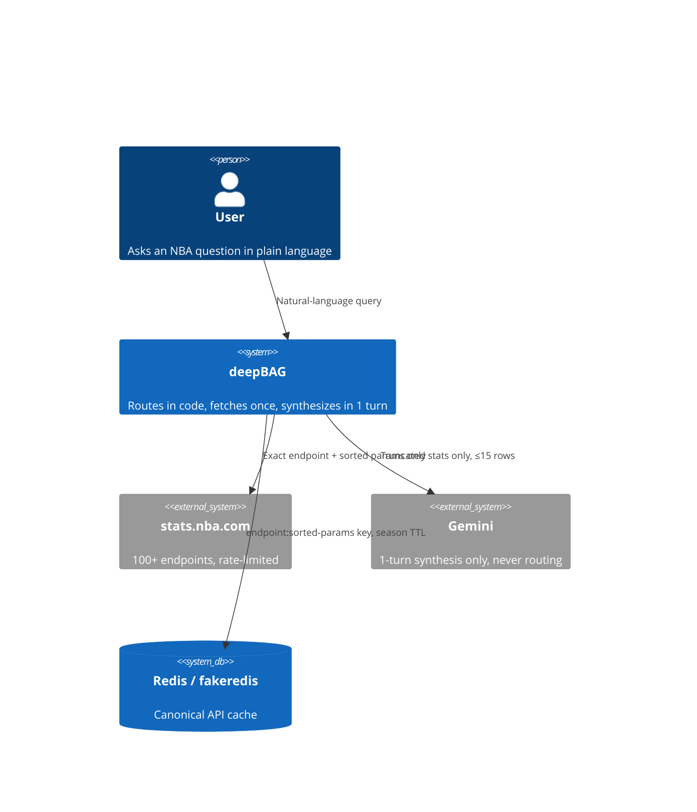
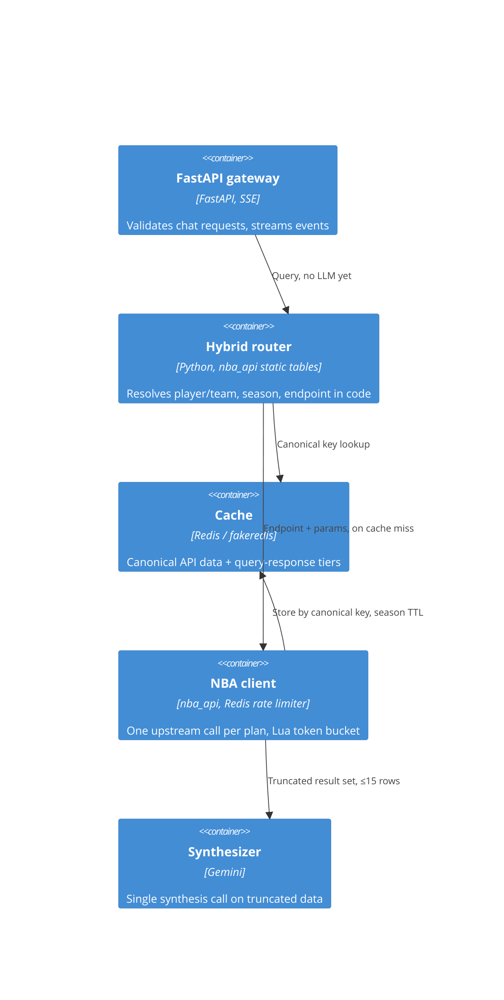

# deepBAG

**Thesis: route an NBA question to the exact endpoint in deterministic code, fetch it once, and only then let an LLM synthesize — so the model never pays to figure out where the data lives.**

Ask in plain language — *"What were LeBron James' points and assists in his most recent game?"* — and deepBAG resolves the player, season, and endpoint in code, calls `stats.nba.com` once, and answers from the returned stats. The LLM does not search for the endpoint. It does not re-read 100+ endpoint schemas. It gets one truncated result set and writes the answer.

## Impact

- **1 LLM call on the happy path**, vs up to 8 iterations in the previous Gemini function-calling loop. [Measured by code path, `nlp/synthesizer.py`]
- **0 LLM calls for routing.** Entity resolution, season extraction, and endpoint selection run in `nlp/hybrid_router.py` before any model call.
- **≤15 rows sent to the LLM**, truncated in code — and the Chart.js spec is injected only when the query is a comparison/trend or the data has ≥3 comparable rows, not on every turn.
- **Canonical cache hits across phrasings of the same call.** Same endpoint + same params in any order = same Redis key. Season TTL: 30 days for seasons before 2024, 12 hours for active seasons.
- **A CI gate, not a claim.** `tests/evals/test_deepbag_evals.py` runs a 50-query fixture and blocks on tool-selection F1 < 0.85 or parameter-extraction accuracy < 0.85. The gate exists in code; a passing score is not claimed here until a CI run is posted.

## Benchmarks

| Metric | Hybrid (now) | Previous agent loop | Delta / what it costs |
| --- | --- | --- | --- |
| LLM calls per query, happy path | 1 | Up to 8 | Fewer roundtrips, less re-charged context |
| LLM calls for routing | 0 | 1+ (via `search_api_docs`) | Routing is code, not a model decision |
| Rows sent to the LLM | ≤15 | 3 in agent summarizer, full dump in naive baseline | More context than the old summarizer, far less than a full dump — a deliberate tradeoff |
| End-to-end latency | Not re-measured | Not re-measured | Old README numbers below are **not** carried forward as facts |
| Token footprint | Not re-measured | Not re-measured | Same — see claim note below |

**Claim note — read this before quoting old numbers.** The previous README claimed 620–1,150ms end-to-end, <350 tokens, 93.5% routing accuracy, and zero 429s. Those were [README claims, pre-hybrid, not re-measured] after the architecture change, so they are **not** repeated as results here. What is verifiable today is structural: 1 synthesis call, 0 routing calls, bounded rows, canonical cache keys, and a 50-query eval gate at 0.85.

## C4 diagram





## Run it in 60 seconds

```bash
git clone https://github.com/jdawg0507/deepBAG.git
cd deepBAG
python -m venv venv && source venv/bin/activate
pip install -r requirements.txt
export GEMINI_API_KEY=<your-key>
uvicorn app:app --host 0.0.0.0 --port 8000
```

Check it is up, then ask it a question:

```bash
curl http://localhost:8000/api/status
curl -X POST http://localhost:8000/api/chat \
  -H "Content-Type: application/json" \
  -d '{"query": "What were LeBron James points and assists in his most recent game?"}'
```

Run the router and cache tests (no API key needed for these):

```bash
pytest tests/test_hybrid_router.py tests/test_cache.py -v
```

## Architecture

- **Hybrid router** (`nlp/hybrid_router.py`) — deterministic intent routing in code: static player/team tables with accent stripping and nickname mapping, season extraction, and keyword intents for docs, historical SQL, `CommonPlayerInfo`, `LeagueDashPlayerStats`, and `PlayerGameLog`. Fallback is `LeagueDashPlayerStats` at confidence 0.8, and only an unknown plan falls back to the old agent loop.
- **Cache** (`core/cache.py`) — Redis with fakeredis fallback. Tier 1 keys on `endpoint:sorted-params`; Tier 2 caches full query responses. Season TTL is implemented, not aspirational: 30 days pre-2024, 12 hours active.
- **Rate limiter** (`core/rate_limiter.py`) — Redis Lua token bucket, 20 requests/minute, burst 5, guarding `stats.nba.com` instead of letting the LLM retry into a 429.
- **Synthesizer** (`nlp/synthesizer.py`) — one Gemini call, temperature 0.2, chart spec injected only on comparison/trend data.
- **Observability** (`core/telemetry.py`) — OpenTelemetry spans + Langfuse, no-op without credentials. It measures the loop; it does not shorten it.

## Where it bleeds — honestly

- **The router is rule-based, not semantic.** There is no embedding cosine-similarity router in the hybrid path; the TF-IDF retriever only serves doc search. Paraphrases outside the keyword intents will miss or fall back.
- **One player per query.** The router matches the earliest player in the query, so *"Compare Giannis and Embiid"* is not a two-player comparison in the hybrid path today — it is a single-player route plus fallback. That old README example does not hold as written.
- **Historical SQL is string-interpolated** and the historical intent list is hard-coded years/legends. It works for the fixture cases; it is brittle outside them.
- **Truncation loses tail data.** 15 rows is a cap, not a summary — a leaderboard query past row 15 is not in the model's context.
- **Not an MCP server.** This is a FastAPI + SSE gateway with an MCP-shaped tool boundary (route → fetch → synthesize). Do not call it an MCP server until an MCP transport is actually shipped.

## What I'd do in your codebase

- Built a deterministic router from constraints; in industry terms that's a LangChain SemanticRouter shape — I can drop this routing logic into SemanticRouter and keep the deterministic plan as the guardrail.
- Built the hybrid path from constraints; in industry terms that's a LangGraph graph with route → fetch → synthesize nodes and the agent loop kept only as a fallback node.
- Built the cache from constraints; in industry terms that's Redis with canonical keys and TTL by data freshness — which is what `core/cache.py` now is.
- Built the eval gate from constraints; in industry terms that's a DeepEval regression gate in CI — tool-selection F1 and parameter accuracy at 0.85, on a 50-query fixture.

## Full spec

The detailed design lives in `backendspecs.md` and `project_specs.md` in this repo. This README is deliberately not a copy of them.

## Stack

Python · FastAPI · Pydantic · Redis / fakeredis · OpenTelemetry · Langfuse · DeepEval · pytest · Vite / React · Gemini · `nba_api`
