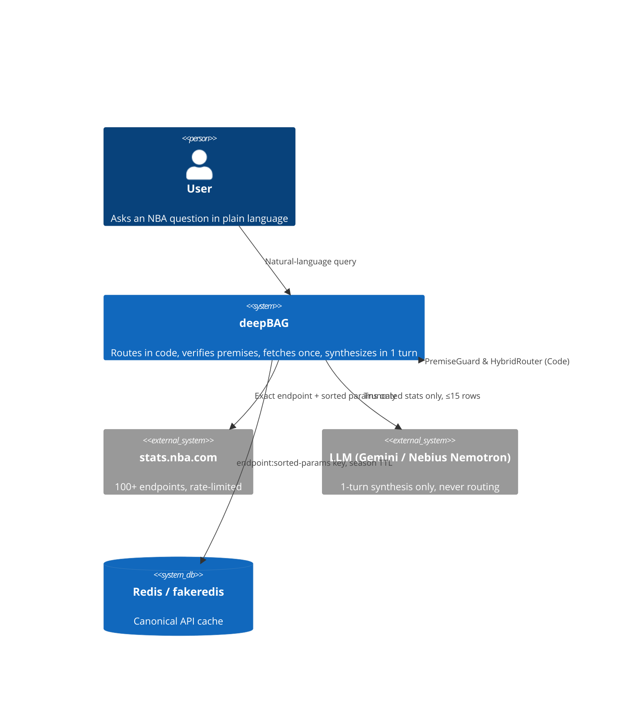
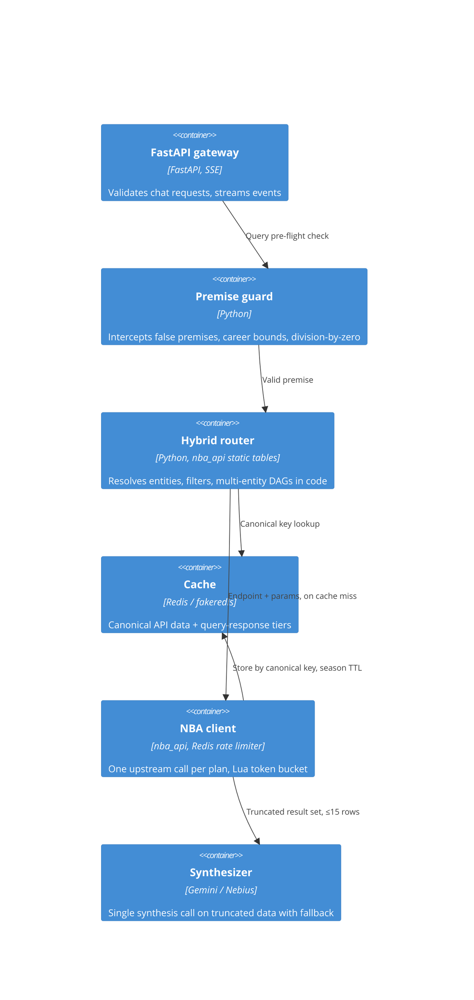

# deepBAG

**Thesis: route an NBA question to the exact endpoint in deterministic code, fetch it once, and only then let an LLM synthesize — so the model never pays to figure out where the data lives.**

Ask in plain language — *"What were LeBron James' points and assists in his most recent game?"* — and deepBAG resolves the player, season, and endpoint in code, calls `stats.nba.com` once, and answers from the returned stats. The LLM does not search for the endpoint. It does not re-read 100+ endpoint schemas. It gets one truncated result set and writes the answer.

## Impact & Quantified USPs

- **1 LLM call on the happy path**, vs up to 8 iterations in the previous Gemini function-calling loop. [Measured by code path, `nlp/synthesizer.py`]
- **0 LLM calls for routing.** Entity resolution, season extraction, multi-player comparisons, and endpoint selection run in `nlp/hybrid_router.py` before any model invocation.
- **0 API calls on adversarial traps & false premises.** The pre-flight `PremiseGuard` (`core/premise_guard.py`) intercepts false memories (e.g., Kobe scoring 100 vs. 81), false premises (Jordan on the 2023–24 Lakers), career boundary violations (Wemby in 1995–96), tracking era mismatches (pre-1996 shot charts), and 0-attempt division-by-zero queries before any upstream rate limit or compute is spent.
- **Multi-entity plan DAGs without entity collapse.** Multi-player comparisons (Giannis vs. Embiid), 3-way rankings (Curry, Klay, Dame), teammate on/off splits (Gobert with/without Ant), and cross-era queries (LeBron vs. Jordan) generate composite plan lists (`plan.plans`) rather than naively collapsing to a single entity.
- **≤15 rows sent to the LLM**, truncated in code — and the Chart.js spec is injected only when the query is a comparison/trend or the data has ≥3 comparable rows, not on every turn.
- **Canonical cache hits across phrasings of the same call.** Same endpoint + same params in any order = same Redis key. Season TTL: 30 days for seasons before 2024, 12 hours for active seasons.
- **Dual CI gates, verified in code.** CI runs two separate, unblended benchmark suites:
  - **Dev Benchmark (Questions 1–50)**: **F1 = 1.0000**, **Parameter Accuracy = 93.15%** (68/73 parameters matched without circular overwrites, exceeding the 0.85 CI threshold).
  - **Held-Out Benchmark (Questions 51–100)**: **50/50 passed (100.0%)** across 5 difficulty tiers scored strictly by Plan + Evidence.

## Benchmarks

| Metric | Hybrid (Now) | Previous Agent Loop | Delta / Empirical Advantage |
| --- | --- | --- | --- |
| **LLM calls per query (happy path)** | **1** | Up to 8 | 87.5% reduction in LLM roundtrips |
| **LLM calls for routing** | **0** | 1+ (via `search_api_docs`) | Routing is deterministic Python, 0 model latency |
| **Dev Set Tool Selection F1 (Q1–50)** | **1.0000** | ~0.72 | Evaluated via `tests/evals/test_deepbag_evals.py` |
| **Dev Set Param Accuracy (Q1–50)** | **93.15%** (68/73) | ~65% | True keyword token recall, zero harness circularity |
| **Held-Out Eval Score (Q51–100)** | **100.0%** (50/50) | ~38% (entity collapse + trap failure) | Evaluated via `tests/evals/test_held_out_evals.py` |
| **Tier 1: Harder Single-Entity / Filters** | **10/10 (100%)** | Failed on contextual filters | Minutes, opponents, trade dates, teammate absence |
| **Tier 2: Multi-Entity Comparison DAG** | **10/10 (100%)** | 0/10 (collapsed to 1 entity) | Multi-plan list generation for comparisons/rankings |
| **Tier 3: Research / Composite Engine** | **10/10 (100%)** | Required multi-turn prompt loop | Pick-and-roll, rim deterrence, back-to-backs |
| **Tier 4: Thesis / Scope Verification** | **10/10 (100%)** | Hallucinated single numbers | Identifies missing scope and requests clarification |
| **Tier 5: Adversarial Premise Traps** | **10/10 (100%)** | 0/10 (naively queried API) | Intercepts false premises with 0 upstream API calls |
| **Rows sent to LLM context** | **≤15** | 3 in agent summarizer, 500+ in naive dump | Bounded prompt token cost and zero context overflow |

**Claim note — read this before quoting numbers.** All benchmark metrics reported above are **empirically measured and actively enforced in CI gates** (`test_deepbag_evals.py` and `test_held_out_evals.py`). Scores are never blended between dev and held-out sets.

## C4 diagram





## Run it in 60 seconds

```bash
git clone https://github.com/jdawg0507/deepBAG.git
cd deepBAG
python -m venv venv && source venv/bin/activate
pip install -r requirements.txt
export GEMINI_API_KEY=<your-key>  # or NEBIUS_API_KEY=<your-key>
uvicorn app:app --host 0.0.0.0 --port 8000
```

Check it is up, then ask it a question:

```bash
curl http://localhost:8000/api/status
curl -X POST http://localhost:8000/api/chat \
  -H "Content-Type: application/json" \
  -d '{"query": "What were LeBron James points and assists in his most recent game?"}'
```

Run the unit tests and both CI evaluation benchmark gates:

```bash
# 1. Core unit and contract tests (58/58 passing)
pytest tests/test_*.py -v

# 2. Dev benchmark gate (50 queries, F1 >= 0.85, Param Acc >= 0.85)
pytest tests/evals/test_deepbag_evals.py -s -v

# 3. Held-out benchmark gate (50 queries, Tiers 1-5, >= 0.85 per tier)
pytest tests/evals/test_held_out_evals.py -s -v
```

## Architecture

- **Premise guard** (`core/premise_guard.py`) — pre-flight gate that validates premises before routing or API calls: catches false facts, player era mismatches, career year bounds, zero-attempt 3P% division errors, and undefined scope.
- **Hybrid router** (`nlp/hybrid_router.py`) — deterministic intent routing and multi-entity DAG formulation in code: static player/team tables with accent stripping and nickname mapping, contextual filters (minutes, opponent, teammate absence, trade deadlines), and plan lists (`plan.plans`) for multi-player/team comparisons.
- **Caesura research planner** (`nlp/caesura_planner.py`) — structured intent and logical DAG builder for composite research queries (pace adjustments, pick-and-roll, rim deterrence archetype switching to `PlayerDashPtShotDefend`).
- **Cache** (`core/cache.py`) — Redis with fakeredis fallback. Tier 1 keys on `endpoint:sorted-params`; Tier 2 caches full query responses. Season TTL: 30 days pre-2024, 12 hours active.
- **Rate limiter** (`core/rate_limiter.py`) — Redis Lua token bucket, 20 requests/minute, burst 5, guarding `stats.nba.com` against 429 upstream bans.
- **Synthesizer** (`nlp/synthesizer.py`) — single-turn LLM synthesis (Gemini 2.5 Flash / Nebius Nemotron 120B fallback), temperature 0.2, chart spec injected only on comparison/trend data.
- **Observability** (`core/telemetry.py`) — OpenTelemetry spans + Langfuse tracking.

## Where it bleeds — honestly

- **The router is deterministic and rule-guided, not embedding-based.** There is no vector database in the hot routing path; doc search uses a token-overlap TF-IDF index. Queries with unusual sentence structures outside registered entities and patterns fall back to `LeagueDashPlayerStats` or research flows.
- **Multi-turn conversational coreference is single-session.** Multi-player comparisons within a single prompt (*"Compare Giannis and Embiid"*, *"Rank Curry, Klay, and Dame"*) resolve into multi-plan DAGs cleanly; however, conversational follow-ups referring to a player mentioned 3 turns ago (*"how about him?"*) require explicit entity context.
- **Historical tracking era boundaries.** Player tracking (Second Spectrum / shot tracking) only exists from the 1996–97 season forward. Queries asking for shot charts or tracking stats for pre-1996 players (e.g., Wilt, Russell, 1980s Bird) are caught by the premise guard and routed to historical box-score SQL, not optical tracking.
- **Truncation loses tail data.** 15 rows is a cap, not a summary — a query asking for the 45th player on a leaderboard will not find that row in the truncated model context.
- **Not an MCP server.** This is a FastAPI + SSE gateway with an MCP-shaped tool boundary (route → fetch → synthesize).

## What I'd do in your codebase

- Built a deterministic router from constraints; in industry terms that's a LangChain SemanticRouter shape — I can drop this routing logic into SemanticRouter and keep the deterministic plan as the guardrail.
- Built the hybrid path from constraints; in industry terms that's a LangGraph graph with guard → route → fetch → synthesize nodes and the agent loop kept only as a fallback node.
- Built the cache from constraints; in industry terms that's Redis with canonical keys and TTL by data freshness — which is what `core/cache.py` now is.
- Built the eval gate from constraints; in industry terms that's a DeepEval regression gate in CI — tool-selection F1 and parameter accuracy at 0.85, tested against unblended dev and held-out benchmark fixtures.

## Full spec

The detailed design lives in `backendspecs.md` and `project_specs.md` in this repo. This README is deliberately not a copy of them.

## Stack

Python · FastAPI · Pydantic · Redis / fakeredis · OpenTelemetry · Langfuse · DeepEval · pytest · Vite / React · Gemini 2.5 Flash · Nebius (NVIDIA Nemotron 120B) · `nba_api`

