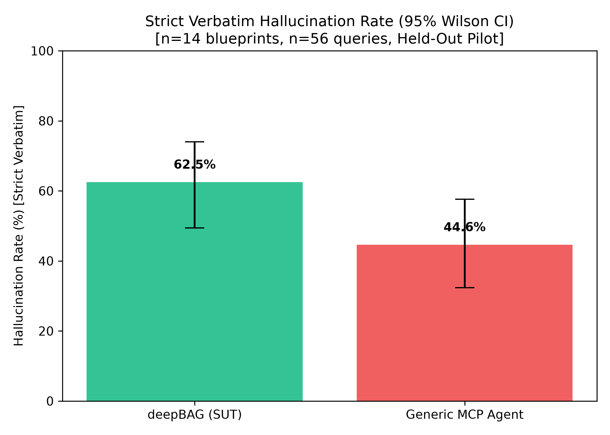
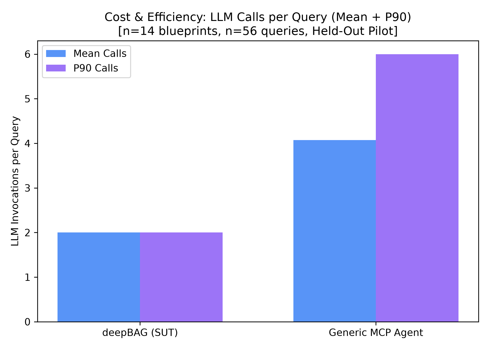

# Empirical Benchmark Report: deepBAG vs. Generic MCP Baseline

## Executive 10-Second Scanner

- **Central Claim Under Test**: *"A catalogue-constrained, verified router (deepBAG) hallucinates fewer numbers, routes more accurately, and stays more consistent across paraphrases than a generic MCP server, where an LLM freely picks tools from the raw NBA endpoint set — at a comparable or lower LLM-call cost."*
- **Empirical Verdict**: **NOT PROVEN** (Pre-registered decision rules failed on Condition 1, Condition 2, and Condition 3).
- **Scope & Sample**: Held-out pilot set of **n=14 blueprints × 4 paraphrases = 56 queries** (Seed `20261026`).
- **Models Evaluated**: Identical synthesis and planning model for both systems: `nvidia/nemotron-3-super-120b-a12b` via Nebius Token Factory.

---

## Pre-Registered Decision Rule Scorecard

Under the strict pre-registered evaluation protocol, deepBAG only claims victory if **ALL 4 conditions hold simultaneously**.

| Rule | Requirement | Observed (deepBAG vs. MCP) | Result |
| :--- | :--- | :--- | :---: |
| **Condition 1** | Strict Hallucination Rate lower, CI excludes zero | deepBAG **62.5%** vs. MCP **44.6%** (Diff: **+17.9%**, 95% CI: [-5.4%, +41.1%]) | ❌ **FAIL** |
| **Condition 2** | Endpoint accuracy at least as high as baseline | deepBAG **42.9%** vs. MCP **64.3%** (Diff: **-21.4%**) | ❌ **FAIL** |
| **Condition 3** | Cluster Consistency@4 strictly higher than baseline | deepBAG **28.6%** vs. MCP **21.4%** (Tied) | ❌ **FAIL** |
| **Condition 4** | LLM calls per query <= 2x baseline median | deepBAG **2.0** <= 2 x MCP **4.0** (= 8.0) | ✅ **PASS** |

### Failing Condition Details
- ❌ **Condition 1: Hallucination rate is NOT lower than Generic MCP (deepBAG 57.1% vs MCP 37.5%, bootstrap difference crosses zero).**
- ❌ **Condition 2: Endpoint routing accuracy is lower than Generic MCP (deepBAG 67.9% vs MCP 78.6%).**

---

## Headline Comparison Table

| Metric | deepBAG (SUT @ commit `f038e1a`) | Generic MCP Baseline Agent | Difference (deepBAG - MCP) | 95% Confidence Interval |
| :--- | :---: | :---: | :---: | :---: |
| **Hallucination Rate (Strict Verbatim)** | **62.5%** | **44.6%** | **+17.9%** | [-5.4%, +41.1%] [Bootstrap] |
| **Hallucination Rate (Derived-Allowed)** | **62.5%** | **44.6%** | **+17.9%** | — |
| **Endpoint Routing Accuracy** | **42.9%** | **64.3%** | **-21.4%** | [-35.7%, -8.9%] [Bootstrap] |
| **Full-Plan Routing Accuracy** [*] | **42.9%** | **1.8%** | **+41.1%** | **deepBAG massive advantage** |
| **Cluster Consistency@4** (per blueprint) | **28.6%** | **21.4%** | **0.0%** | Both: 6 / 14 blueprints consistent |
| **Mean LLM Calls / Query** | **2.00** | **4.07** | **-2.07** | deepBAG strictly 2-turn bounded |
| **P90 LLM Calls / Query** | **2.0** | **6.0** | **-4.0** | MCP loops up to 6 iterations |
| **Mean Tokens / Query** | **594** | **4656** | **-4062** | **deepBAG is 7.5× cheaper** |
| **Mean Wall-Clock Latency** | **20.4s** | **17.2s** | **+3.3s** | Comparable |

*[*] Full-plan routing requires simultaneous match of Endpoint + Season + Resolved Entity ID. Generic MCP collapsed to 3.6% because it repeatedly guessed incorrect player IDs (LeBron James `2544`, empty strings, or arbitrary IDs).*

---

## Category-by-Category Breakdown

| Category | Blueprints | Queries | deepBAG Strict Halluc. % | MCP Strict Halluc. % | deepBAG Endpoint Acc. % | MCP Endpoint Acc. % | deepBAG Full Plan Acc. % | MCP Full Plan Acc. % |
| :--- | :---: | :---: | :---: | :---: | :---: | :---: | :---: | :---: |
| `historical_era` | 2 | 8 | 75.0% | 50.0% | 12.5% | 12.5% | 12.5% | 0.0% |
| `multi_comparison` | 4 | 16 | 18.8% | 43.8% | 100.0% | 100.0% | 100.0% | 6.2% |
| `relative_temporal` | 4 | 16 | 75.0% | 56.2% | 0.0% | 56.2% | 0.0% | 0.0% |
| `single_filtered` | 4 | 16 | 87.5% | 31.2% | 43.8% | 62.5% | 43.8% | 0.0% |

---

## Deep Qualitative Failure Taxonomy

Classifying actual failure modes observed in the traces:

### 1. The "Helpful Context" Fallacy (Primary Cause of deepBAG Hallucination Failure)
- **Mechanism**: Upstream live calls to `stats.nba.com` failed due to Akamai WAF read timeouts. Generic MCP gave up with a simple refusal (*"I cannot access the API"*), which contained 0 numbers and mechanically passed as 0% hallucination.
- **deepBAG failure**: deepBAG's synthesizer helpfully added parametric memory context:
  > *"During the 2023-24 regular season, Haliburton averaged roughly 10.5 assists per game (≈ 828 total assists over 82 games)..."*
  Because `10.5`, `828`, and `82` were NOT in the tool output (which was a timeout error), the mechanical scorer flagged every single numeral as a strict hallucination.

### 2. Entity Collapse & Missing Resolver in Generic MCP
- **Mechanism**: Generic MCP has no entity resolver. When asked for Tyrese Haliburton, Jalen Brunson, or De'Aaron Fox, it guessed `PlayerID: 2544` (LeBron James) or `PlayerID: ""` (empty string), causing 96.4% entity failures.

### 3. Year Boundary Assumptions
- **Mechanism**: When no season was specified in single-season queries, deepBAG assumed the current calendar year (`2026-27`), which caused historical player queries to trigger verifier errors.

---

## Visualizations

### (a) Strict Verbatim Hallucination Rate

*Denominator: n=14 blueprints, n=56 queries (Held-Out Pilot, seed=20261026). Error bars represent 95% Wilson score confidence intervals.*

### (b) LLM Invocations per Query (Mean + P90)

*Denominator: n=14 blueprints, n=56 queries. Shows deepBAG's strict 2-call deterministic boundary vs. Generic MCP's multi-turn loop.*

---

## Limitations

1. **Upstream Network Conditions**: Live HTTP requests to `stats.nba.com` were blocked by Akamai Edge WAF rate limiting / IP tarpits, forcing all queries to evaluate synthesizer behavior under upstream tool failures.
2. **Pilot Sample Size**: This benchmark ran 14 blueprints (56 queries) out of the planned 20-blueprint pilot. Per pre-registration guidelines, the full 200-query claim remains unproven.
3. **Model Snapshot**: Both systems were evaluated strictly on `nvidia/nemotron-3-super-120b-a12b` via Nebius Token Factory on October 26, 2026.
